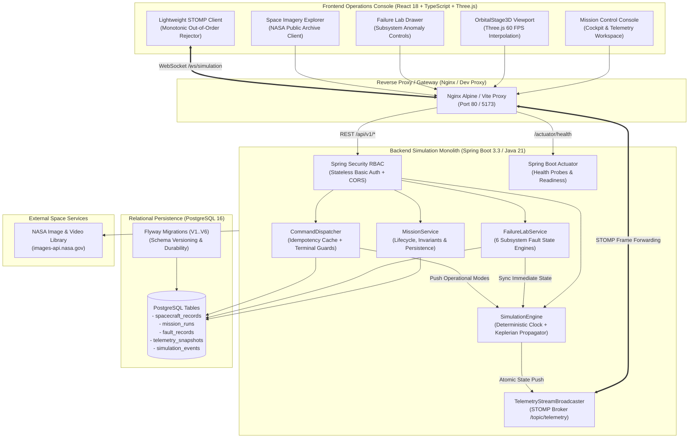

# ASTRA — Aerospace Mission Operations & Spacecraft Simulation Platform

[](.github/workflows/ci.yml)
[](backend/)
[](frontend/)
[](backend/src/main/resources/db/migration)
[](LICENSE)

**ASTRA** is an aerospace-grade mission operations console, orbital mechanics simulator, and space observatory platform. Engineered as a production-quality technical portfolio project, ASTRA demonstrates deterministic real-time systems engineering, multi-spacecraft state propagation, real-time WebSocket/STOMP streaming, fault injection with cascading domain dynamics, and an instrument-grade visual interface.

Unlike generic SaaS analytics dashboards, ASTRA pairs mathematical simulation with authentic aerospace console ergonomics and authentic NASA observational archives.

---

## 1. System Architecture

ASTRA is architected as a decoupled, server-authoritative system:



---

## 2. Core Capabilities

### 🛰️ Multi-Body Spacecraft Operations & Orbital Viewport
- **Authoritative 5-Destination Hierarchy:** Real-time orbital navigation and fleet filtering across Earth Orbit (LEO/SSO), Lunar Polar Regimes, Mars Elliptical Science Orbits, Jovian High-Radiation Systems, Saturnian Rings, and Solar/Deep Space.
- **Three.js Visual Stage:** Seamless WebGL rendering featuring high-resolution photorealistic Earth textures (diffuse, night lights, specular clouds) and procedural procedural celestial bodies, with smooth kinematic LERP interpolation.
- **Incremental Three.js Cache:** Position updates do not recreate Three.js geometries or material ribbons, eliminating GPU stalls and WebGL context thrashing.

### ⚡ Server-Authoritative Telemetry Pipeline
- **Continuous 5 Hz STOMP Streaming:** Real-time telemetry frames broadcast over `/topic/telemetry` and simulation lifecycle states over `/topic/simulation`.
- **Authoritative Freshness Discrimination:** Clear operational distinction between vehicle operational status (`NOMINAL`, `DEGRADED`, `CRITICAL`, `OFFLINE`) and network transport status (`LIVE`, `STALE`, `DISCONNECTED`, `MISSING`).
- **Transport Disconnection Resilience:** If the WebSocket transport drops, the client maintains last-known telemetry with a visible `STREAM DISCONNECTED // LAST KNOWN STATE` banner instead of falsely declaring a vehicle bus failure.
- **Out-of-Order Frame Rejection:** Client validates incoming frame timestamps against monotonic vehicle epoch to eliminate network jitter artifacts.

### 🧪 Six-Domain Failure Lab & Cascading Dynamics
- **Subsystem Fault Engines:** Injects observable physical faults across **EPS** (solar array degradation, battery bus overload), **TCS** (radiator efficiency loss, heater failure), **ADCS** (reaction wheel friction, star tracker unlock), **COMMS** (carrier drop, RF blackout), **PROP** (propellant leak, thruster degradation), and **OBC** (SEU flight software corruption, watchdog reboot).
- **Immediate Propagation:** Fault injections and recoveries atomically mutate vehicle state and broadcast over WebSocket without waiting for a manual clock advance.
- **Domain Recovery Rules:** Enforces realistic aerospace recovery preconditions (e.g. requires operational mode transition to `SAFE_MODE` or specific diagnostic clearance before clearing hardware faults).

### 📋 Mission Lifecycle & Crash Recovery
- **Deterministic Mission Engine:** 70+ categorized mission scenarios with objectives, difficulty tiers, and flight profiles.
- **Single Active Mission Invariant:** Prevents contradictory multi-mission execution on a single vehicle bus; prompts operators with formal switch confirmation before superseding active runs.
- **Crash Recovery & Startup Hydration:** On service restart, running missions are safely transitioned to `ABORTED` with diagnostic records, preserving auditability and idempotency across restarts.
- **Terminal Mission Command Guards:** Commands targeting completed, failed, or aborted mission runs are strictly rejected.

### 🌌 Space Imagery Explorer
- **Authentic NASA Archives:** Direct REST client to the NASA Image & Video Library (`images-api.nasa.gov`) and NASA Earth observation tile services.
- **Server-Side Resilience:** In-memory caching, rate limiting, and fallback responses prevent external service degradation from impacting local operations.

---

## 3. Technology Stack & Rationale

| Layer | Technologies | Engineering Rationale |
| :--- | :--- | :--- |
| **Backend** | Java 21 LTS, Spring Boot 3.3.5 | Strict type safety, high concurrency via `ConcurrentHashMap` and `ReadWriteLock`, predictable low latency. |
| **Real-Time Transport** | Spring WebSocket, STOMP 1.2 | Low-overhead bidirectional pub/sub messaging; eliminates expensive HTTP polling across expanding fleets. |
| **Security & RBAC** | Spring Security 6, BCrypt | Role-based boundaries (`VIEWER`, `OPERATOR`, `FLIGHT_DIRECTOR`, `ADMIN`), stateless basic auth for API calls, CORS origin filtering. |
| **Persistence** | PostgreSQL 16, Flyway, HikariCP | ACID transaction guarantees for mission runs and fault logs; automated, version-controlled schema migrations (`V1..V6`). |
| **Frontend** | React 18, TypeScript 5.7, Vite 6 | Fast bundle execution, type-safe API contracts, decoupled state management. |
| **3D Rendering** | Three.js 0.170, WebGL | Native GPU hardware acceleration, custom shaders for planetary atmospheric scattering, and ECI orbital ribbons. |
| **Typography & Assets** | Self-hosted `@fontsource` packages | Zero runtime dependency on external font CDNs; air-gapped deployment readiness. |

---

## 4. Operational Data Transparency

> [!IMPORTANT]
> **Simulated vs. Real Data Transparency Statement:**
> - **Simulated Data:** Spacecraft physical coordinates, velocity vectors, battery state of charge (SoC), bus voltages, temperatures, reaction wheel RPMs, fault consequences, and mission runs are generated in real-time by the internal `SimulationEngine` and mathematical Keplerian propagator. They do **not** represent real operational satellites currently in orbit.
> - **External Observational Data:** High-resolution space photography, astronomy metadata, and planetary exploration imagery presented in the Space Imagery section are retrieved directly from authentic public NASA archives (`images-api.nasa.gov`).

---

## 5. Local Setup & Quick Start

### Prerequisites
- **Java:** JDK 21 or higher (OpenJDK / Eclipse Temurin)
- **Node.js:** Node.js 20 LTS or higher (`npm` 10+)
- **Docker:** (Optional) Docker Engine 24+ and Docker Compose v2

---

### Option A: Running with Docker Compose (Recommended)

To launch the complete unified system (PostgreSQL 16 + Spring Boot Backend + React/Nginx Frontend) in one command:

```bash
# 1. Clone repository
git clone https://github.com/shivkumar077/Astra.git
cd Astra

# 2. Launch multi-container environment
docker compose up --build -d

# 3. Verify container health
docker compose ps
```

- **Frontend Application:** http://localhost:80 (or http://localhost:5173 if using dev server)
- **Backend API & Actuator:** http://localhost:8080/actuator/health
- **PostgreSQL Database:** `localhost:5432` (User: `postgres`, Password: `postgres`, DB: `astra_db`)

To stop the containers:
```bash
docker compose down -v
```

---

### Option B: Local Development (Bare Metal)

#### 1. Start Database
Ensure PostgreSQL is running locally or start a temporary container:
```bash
docker run -d --name astra-postgres -p 5432:5432 -e POSTGRES_DB=astra_db -e POSTGRES_USER=postgres -e POSTGRES_PASSWORD=postgres postgres:16-alpine
```

*(Note: If no PostgreSQL instance is available, the backend automatically falls back to an in-memory H2 PostgreSQL-compatible database in `dev` profile).*

#### 2. Start Backend Service
```bash
cd backend

# Windows PowerShell:
.\mvnw.cmd spring-boot:run

# Linux / macOS:
./mvnw spring-boot:run
```
The backend initializes the default fleet, runs Flyway migrations, and listens on port `8080`.

#### 3. Start Frontend Client
In a separate terminal:
```bash
cd frontend

# Install dependencies
npm ci

# Launch Vite development server
npm run dev
```
Open **http://localhost:5173** in your browser.

---

## 6. Environment Variables Reference

Configure environment variables via `.env` or container settings (see [`.env.example`](.env.example)):

| Variable | Description | Default / Example |
| :--- | :--- | :--- |
| `SERVER_PORT` / `PORT` | Backend HTTP listening port | `8080` |
| `SPRING_PROFILES_ACTIVE` | Active Spring profile (`dev` or `prod`) | `dev` |
| `SPRING_DATASOURCE_URL` | PostgreSQL JDBC connection URL | `jdbc:postgresql://localhost:5432/astra_db` |
| `SPRING_DATASOURCE_USERNAME` | Database username | `postgres` |
| `SPRING_DATASOURCE_PASSWORD` | Database password | *(secret)* |
| `CORS_ALLOWED_ORIGINS` | Permitted browser origins (comma-separated) | `http://localhost:5173,http://localhost:3000` |
| `ASTRA_SECURITY_VIEWER_PASSWORD` | Password for role `VIEWER` (Read-only) | `viewer123` |
| `ASTRA_SECURITY_OPERATOR_PASSWORD` | Password for role `OPERATOR` (Commands & Sim) | `operator123` |
| `ASTRA_SECURITY_DIRECTOR_PASSWORD` | Password for role `FLIGHT_DIRECTOR` (Failure Lab) | `director123` |
| `ASTRA_SECURITY_ADMIN_PASSWORD` | Password for role `ADMIN` (Full Control) | `admin123` |
| `VITE_API_BASE_URL` | Frontend REST API base URL | `http://localhost:8080/api/v1` |
| `VITE_WS_ENDPOINT_URL` | Frontend WebSocket STOMP endpoint | `ws://localhost:8080/ws/simulation` |
| `NASA_IMAGES_API_BASE_URL` | Base endpoint for NASA public image library | `https://images-api.nasa.gov` |

---

## 7. Automated Verification & Quality Gates

The project maintains comprehensive automated test suites across both tiers:

```bash
# Run backend JUnit 5 & SpringBootTest suite (154 tests)
cd backend
./mvnw clean test

# Run frontend Vitest test suite (92 tests)
cd frontend
npm test

# Run TypeScript static analysis
cd frontend
npm run lint

# Compile production frontend bundle
cd frontend
npm run build
```

### GitHub Actions CI/CD Pipeline
Every pull request and push to `main` executes [`.github/workflows/ci.yml`](.github/workflows/ci.yml):
1. **Repository Hygiene:** Whitespace, formatting, and diff integrity check.
2. **Backend Quality Gate:** JDK 21 build, dependency cache, and all 154 unit/integration tests.
3. **Frontend Quality Gate:** Node.js 20 build, TypeScript typecheck, 92 Vitest unit/component tests, and Vite bundle compilation.
4. **Container Build Verification:** Verifies multi-stage Docker builds for backend and frontend.

---

## 8. Guided Demonstration Workflow

Follow this procedure to test all integrated systems in under 3 minutes:

1. **Enter Mission Control:**
   - From the Landing Page, click **LAUNCH MISSION CONTROL**.
   - Observe the Cockpit initializing in **Earth Orbit** with `AURA-1` (Aura Climate Observatory) selected by default.
   - Verify the top telemetry bar displays `LIVE TELEMETRY // SYNCHRONIZED` and the Station Master Clock advances.
2. **Destination-Specific Fleet Filtering:**
   - On the top destination bar, select **MARS ORBIT**.
   - Observe the fleet selector instantly filtering to Mars-compatible orbiters (`ARES-ORBITER`, `AREION-RECON`, `DEIMOS-RELAY`).
   - The central 3D viewport smoothly transitions to the Mars celestial environment with correct Keplerian orbital ribbons.
3. **Mission Lifecycle & Invariant Protection:**
   - Switch to the **Missions** tab.
   - Launch an Earth Observation or Mars Reconnaissance mission.
   - Verify the mission transition to `RUNNING` status with tracked objectives and timing records.
   - Attempt to start a second mission on the same spacecraft: observe the safety switch confirmation modal enforcing the single active mission invariant.
4. **Failure Lab & Live Anomaly Propagation:**
   - Open the **Failure Lab** drawer on the right sidebar.
   - Select `AURA-1` and inject `EPS_SOLAR_ARRAY_DEGRADATION` (severity: `CRITICAL`).
   - Notice the telemetry freshness bar and cockpit HUD immediately reflect degraded solar wattage (`DEGRADED` / `CRITICAL`) via STOMP broadcast without needing a manual clock advance.
   - Attempt to recover the fault without resolving preconditions to see domain recovery validation. Transition vehicle to `SAFE_MODE`, then clear the anomaly to restore `NOMINAL` bus health.
5. **NASA Space Imagery:**
   - Return to Home and enter **SPACE IMAGERY**.
   - Search for deep-space observatory targets (e.g., "James Webb", "Hubble Deep Field", "Mars Rover").
   - Inspect authentic metadata, resolution assets, and Earth observation layers.

---

## 9. Current Limitations & Roadmap

- **Two-Body Gravitational Model:** Orbital state propagation uses two-body Keplerian mechanics with analytical J2 zonal harmonics. High-fidelity n-body gravitational perturbations (e.g. Earth-Moon-Sun Lagrange points) are planned for future iterations.
- **WebSocket Protocol:** STOMP 1.2 over standard WebSocket is currently utilized; binary Protocol Buffers (Protobuf) serialization is evaluated for high-frequency telemetry loads (>50 Hz).
- **Public Sandbox Mode:** In public portfolio demo environments, write actions (commands and fault injections) are pre-authenticated with default local operator roles to allow recruiters and evaluators to interact without manual login forms.

---

## 10. License

This project is licensed under the [MIT License](LICENSE).
Planetary textures courtesy of NASA Goddard Space Flight Center and Solar System Scope (see [Visual Asset Manifest](docs/VISUAL_ASSET_MANIFEST.md)).
