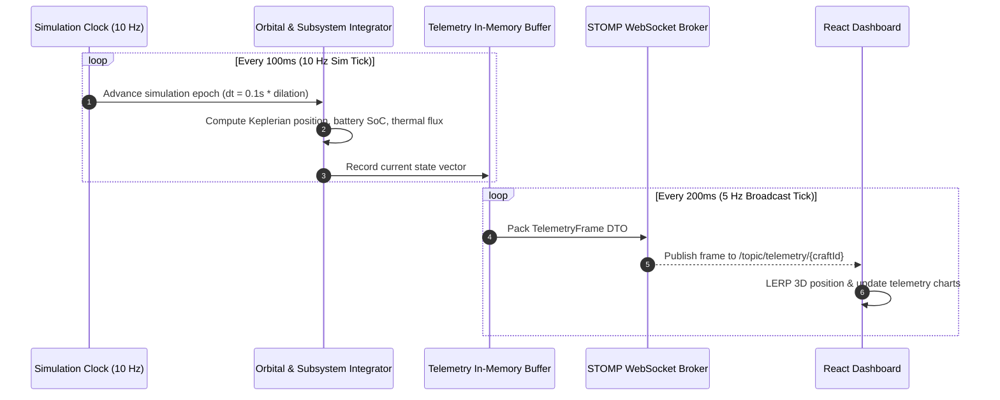
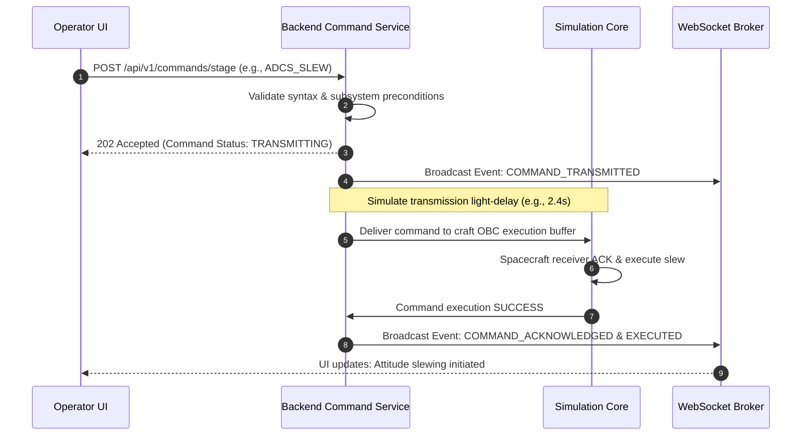

# ASTRA — System Architecture

**Document Version:** 1.0.0  
**Status:** Approved for Implementation (Phase 1)  
**Author:** Technical Architecture & Systems Engineering  
**Repository:** Astra

---

## 1. Architectural Philosophy & System Topology

ASTRA is designed as a **Modular Monolith** powered by **Java 21** and **Spring Boot 3.x** on the backend, paired with a modern **React + TypeScript + Vite + Three.js** single-page client, persisting to **Supabase-hosted PostgreSQL**.

```
+---------------------------------------------------------------------------------------------------------+
|                                              ASTRA CLIENT                                               |
|                                       (React / TypeScript / Vite)                                       |
|                                                                                                         |
|  +---------------------------+  +---------------------------+  +-------------------------------------+  |
|  |     Mission Control UI    |  |     Space Imagery UI      |  |      Three.js Orbital Viewport      |  |
|  |  - Telemetry Strip Charts |  |  - NASA Search & Filter   |  |  - Celestial Ephemeris              |  |
|  |  - Subsystem Matrix       |  |  - High-Res Inspector     |  |  - Orbit Trajectory Ribbons         |  |
|  |  - Command Terminal       |  |  - Metadata Sheet         |  |  - Spacecraft Attitude Rendering    |  |
|  |  - Failure Lab Console    |  |  - GIBS Earth Tiles       |  |  - Field-of-View Cone               |  |
|  +---------------------------+  +---------------------------+  +-------------------------------------+  |
|                |                              |                                    |                    |
|                +------------------------------+------------------------------------+                    |
|                                               |                                                         |
+-----------------------------------------------|---------------------------------------------------------+
                                                |
                         HTTP REST / JSON       |        WebSocket (STOMP)
                         (Commands, Queries,    |        (5 Hz Telemetry Broadcast,
                          NASA Gateway)         |         Real-Time Event Stream)
                                                v
+---------------------------------------------------------------------------------------------------------+
|                                          ASTRA BACKEND SERVICE                                          |
|                                   (Spring Boot 3.x / Java 21 Monolith)                                  |
|                                                                                                         |
|  +---------------------------------------------------------------------------------------------------+  |
|  |                                  Web & Transport Layer (REST & WS)                                |  |
|  +---------------------------------------------------------------------------------------------------+  |
|                                                  |                                                      |
|  +-------------------+  +-------------------+  +-------------------+  +------------------------------+  |
|  |  Fleet Management |  | Telemetry Stream  |  |  Command Pipeline |  |     Failure Lab Engine       |  |
|  |  - Craft Configs  |  |  - Frame Packing  |  |  - Validation     |  |  - Subsystem Anomaly FSMs    |  |
|  |  - Mission States |  |  - Ring Buffers   |  |  - Ack Lifecycle  |  |  - Fault Injection           |  |
|  +-------------------+  +-------------------+  +-------------------+  +------------------------------+  |
|            |                      |                      |                            |                 |
|  +---------------------------------------------------------------------------------------------------+  |
|  |                                    Deterministic Simulation Core                                  |  |
|  |  - Monotonic Simulation Clock               - RK4 / Keplerian Orbital Propagator                  |  |
|  |  - Subsystem Integrators (Power/Thermal/ADCS) - Time Dilation & Pause Manager                      |  |
|  +---------------------------------------------------------------------------------------------------+  |
|            |                                                                          |                 |
|  +-------------------+                                                        +----------------------+  |
|  | NASA Gateway API  |                                                        | Persistence & Audit  |  |
|  | - Images API Client                                                       | - Spring Data JPA    |  |
|  | - GIBS WMTS Proxy |                                                        | - Flyway Migrations  |  |
|  | - Cache & Quotas  |                                                        | - HikariCP Pool      |  |
|  +-------------------+                                                        +----------------------+  |
|            |                                                                             |              |
+------------|-----------------------------------------------------------------------------|--------------+
             |                                                                             |
             v                                                                             v
+-----------------------------+                                             +-----------------------------+
|    EXTERNAL NASA SERVICES   |                                             |   SUPABASE MANAGED CLOUD    |
| - images-api.nasa.gov       |                                             | - PostgreSQL Database       |
| - gibs.earthdata.nasa.gov   |                                             | - Row-Level Security (RLS)  |
| - api.nasa.gov (Optional)   |                                             | - Version-Controlled Schema |
+-----------------------------+                                             +-----------------------------+
```

### 1.1 Infrastructure Justification: Monolith vs Microservices
We explicitly reject microservices, Kafka, Redis, and Kubernetes at this stage:
- **Zero Network Serialization Overhead:** In-memory method invocations between the simulation clock, subsystem models, and telemetry packaging happen in nanoseconds, eliminating inter-service network latency and serialization failures.
- **Single Developer Operational Velocity:** A modular monolith can be built, tested, and debugged within a single IDE workspace using standard Maven commands.
- **In-Memory Ring Buffers:** Telemetry streaming needs low-latency circular buffers for the most recent 1,000 points per vehicle. An in-memory data structure in Java 21 handles this with near-zero latency, avoiding the operational overhead of a standalone Redis cluster.
- **Authoritative Determinism:** Keeping the simulation clock and orbital math within a single JVM process prevents split-brain states and distributed clock-skew anomalies.

---

## 2. Spring Boot Backend Domain Boundaries

The backend is structured into clear, decoupled domain packages within the monolithic codebase:

```
org.astra
 ├── core                  # Common types, timestamps, math primitives, physical constants
 ├── simulation            # Clock manager, Keplerian propagator, integration loop
 ├── fleet                 # Spacecraft entities, mission profiles, hardware parameters
 ├── telemetry             # Frame packaging, real-time dispatch, snapshot archive
 ├── commands              # Command staging, validation, uplink delay, execution
 ├── anomalies             # Six-domain failure state machines, fault injection
 ├── camera                # Simulated optical capture pipeline, metadata ledger
 ├── imagery               # NASA client integration, GIBS proxy, caching layer
 └── persistence           # JPA repositories, database entities, Flyway migrations
```

### 2.1 Domain Responsibilities

| Module | Primary Responsibility | Key Invariants |
| :--- | :--- | :--- |
| `core` | Provides coordinate math (ECI, ECEF, LVLH), Julian dates, physical constants ($\mu_{\text{Earth}}$, solar constant). | Pure, immutable functions. No database or network dependencies. |
| `simulation` | Advances physical and subsystem states deterministically based on tick interval ($\Delta t$) and time dilation multiplier. | The simulation clock is monotonic and authoritative. No random perturbations without seeded PRNG. |
| `fleet` | Maintains the catalog of spacecraft, their physical properties (mass, bus voltage, moment of inertia, sensor suites). | State changes occur only via the simulation engine or validated commands. |
| `telemetry` | Serializes vehicle state into `TelemetryFrame` records; buffers recent history; broadcasts via WebSockets. | Broadcast rate is decoupled from simulation tick rate (e.g., 10 Hz sim tick, 5 Hz network broadcast). |
| `commands` | Validates command parameters, simulates transmission delay, triggers execution, and tracks command resolution. | A command cannot transition to `EXECUTED` unless validated by subsystem preconditions. |
| `anomalies` | Holds the state machines for the 6 failure scenarios; injects state modifiers into the simulation core. | An anomaly cannot be cleared unless an appropriate recovery command sequence is executed. |
| `camera` | Calculates field-of-view intercepts, generates telemetry-stamped capture metadata, persists capture logs. | Must explicitly tag all output as synthetic and include vehicle orientation vectors. |
| `imagery` | Connects to NASA endpoints, provides server-side caching, enforces rate limits, proxies GIBS WMTS. | Must never expose NASA API keys to the browser; gracefully handles network disconnects. |
| `persistence` | Manages PostgreSQL tables via Spring Data JPA and Flyway migrations. | Supabase service keys stay strictly on the server; client never queries the database directly. |

---

## 3. Frontend Architecture (React + TypeScript + Three.js)

```
frontend/
 ├── src/
 │    ├── assets/              # Textures, planet normal maps, audio tones
 │    ├── components/          # Reusable instrument widgets
 │    │    ├── common/         # Buttons, panels, badges, modal dialogs
 │    │    ├── telemetry/      # Sparklines, radial gauges, status indicators
 │    │    ├── command/        # Command terminal, staging queues
 │    │    └── viewport/       # Three.js Canvas, celestial camera, orbit lines
 │    ├── features/            # Feature-specific page views
 │    │    ├── missioncontrol/ # Full telemetry console, fleet drawer, failure lab
 │    │    └── spaceimagery/   # NASA library browser, GIBS viewer, metadata sheet
 │    ├── hooks/               # Custom React hooks (useTelemetry, useWebSocket)
 │    ├── services/            # Axios REST client, STOMP WebSocket client
 │    ├── state/               # Lightweight client state store (Zustand or Context)
 │    ├── types/               # TypeScript interfaces matching backend DTOs
 │    ├── App.tsx              # Root application router (Dual-entry navigation)
 │    └── main.tsx             # Entry point
```

### 3.1 3D Viewport Architecture
- **Rendering Loop:** Managed via Three.js `requestAnimationFrame` loop maintaining target 60 FPS.
- **Coordinate Conversion:** Backend propagates orbits in kilometers; Three.js operates in scaled world units ($1\text{ unit} = 1,000\text{ km}$ for orbital scale, with logarithmic depth buffer enabled to prevent z-fighting).
- **Decoupled Interpolation:** Telemetry arrives at 5 Hz. The Three.js render loop linearly interpolates (LERP / SLERP) spacecraft position and quaternion orientation between telemetry packets to ensure silky camera and craft motion.

---

## 4. Database Strategy & Supabase Integration

### 4.1 Persistence Architecture
- **Engine:** PostgreSQL 15+ hosted on Supabase.
- **Migration Tool:** Flyway (SQL-based migrations versioned in `src/main/resources/db/migration`).
- **Connection Strategy:** Spring Boot manages connections via HikariCP directly to Supabase using standard JDBC over TLS (`sslmode=require`).
- **Security & RLS:** Supabase Row Level Security (RLS) is enabled by default. While backend queries execute over an authenticated connection pool, all tables have explicit security policies preventing anonymous external direct access.

```
+---------------------------------------------------------------------------------------+
|                                    FLYWAY MIGRATIONS                                  |
|                                                                                       |
|  V1__initial_schema.sql         -> Core tables: missions, spacecraft, hardware_config |
|  V2__telemetry_and_events.sql   -> Tables: telemetry_snapshots, mission_events        |
|  V3__command_pipeline.sql       -> Tables: commands, command_execution_log            |
|  V4__anomalies_and_captures.sql -> Tables: anomaly_definitions, simulated_captures    |
|  V5__imagery_cache.sql          -> Tables: nasa_asset_cache, gibs_layer_registry      |
+---------------------------------------------------------------------------------------+
```

---

## 5. API Boundaries & Communication Contracts

### 5.1 REST API Specification

| Endpoint | Method | Responsibility | Parameters / Body |
| :--- | :---: | :--- | :--- |
| `/api/v1/fleet` | `GET` | List all active spacecraft and their current status | None |
| `/api/v1/fleet/{id}` | `GET` | Get detailed specification and hardware profile for spacecraft | Path: `id` (UUID) |
| `/api/v1/simulation/time` | `GET` | Get current simulation epoch and time dilation | None |
| `/api/v1/simulation/time/control` | `POST` | Pause, resume, or adjust time dilation | `{ action: "PAUSE"\|"PLAY"\|"SET_DILATION", multiplier: 2.0 }` |
| `/api/v1/telemetry/{id}/history` | `GET` | Get recent historical telemetry ring buffer for vehicle | Query: `limit=100&since={epoch}` |
| `/api/v1/commands/stage` | `POST` | Validate and stage a new spacecraft command | `{ spacecraftId, commandType, parameters }` |
| `/api/v1/commands/{id}` | `GET` | Check command transmission and execution status | Path: `id` |
| `/api/v1/anomalies/catalog` | `GET` | Retrieve the catalog of 6 Failure Lab scenarios | None |
| `/api/v1/anomalies/inject` | `POST` | Inject a failure scenario into a target craft | `{ spacecraftId, anomalyCode, severity }` |
| `/api/v1/anomalies/{instanceId}/recover` | `POST` | Execute emergency recovery action | `{ instanceId, recoverySequence }` |
| `/api/v1/camera/capture` | `POST` | Trigger a simulated optical capture operation | `{ spacecraftId, target, exposureMs }` |
| `/api/v1/imagery/random` | `GET` | Fetch randomized NASA space imagery collection | Query: `count=12` |
| `/api/v1/imagery/search` | `GET` | Search NASA Image and Video Library | Query: `q={query}&media_type=image&page=1` |
| `/api/v1/imagery/gibs/layers` | `GET` | Get active NASA GIBS Earth observation layers | None |

### 5.2 WebSocket Telemetry Protocol (STOMP)

The platform uses Spring WebSocket with STOMP over SockJS fallback:
- **Broker Endpoint:** `/ws/telemetry`
- **Application Destination Prefix:** `/app`
- **Broker Destination Prefix:** `/topic`

#### Subscription Channels:
1. `/topic/telemetry/{spacecraftId}`: High-frequency (5 Hz) state broadcast containing kinematics, power, thermal, comms, and propulsion metrics.
2. `/topic/events/{spacecraftId}`: Operational alerts, orbit milestone crossings (periapsis, eclipse ingress/egress), and command execution ACKs.
3. `/topic/anomalies/{spacecraftId}`: Real-time anomaly status changes, degradation alarms, and recovery state updates.

---

## 6. Major Data Flows

### 6.1 Telemetry Broadcast Loop


### 6.2 Command Uplink & Verification Lifecycle


---

## 7. Operational Diagnostics & Structured Logging

The backend utilizes SLF4J with Logback configured for structured JSON output in production:
- **Trace IDs:** Every incoming REST request and WebSocket session is assigned a unique `traceId` (MDC context).
- **Audit Trails:** All command staging, failure injections, and recovery attempts write an immutable audit log entry containing: `operatorId`, `spacecraftId`, `actionCode`, `simEpoch`, `outcome`.
- **Health Indicators:** Custom Spring Boot Actuator endpoints (`/actuator/health`, `/actuator/metrics`) monitor:
  - Simulation loop drift (jitter in ms between scheduled tick and execution).
  - WebSocket active subscriber count per spacecraft topic.
  - NASA external gateway latency and circuit breaker status.

---

## 8. Phase 2 Implementation Architecture: Deterministic Simulation Engine

### 8.1 Astrodynamics & Coordinate Conventions
- **Central Body:** Earth modeled with WGS 84 / EGM96 gravitational parameter $\mu_\oplus = 398600.4418 \text{ km}^3/\text{s}^2$ and equatorial mean radius $R_\oplus = 6378.137\text{ km}$.
- **Standard Units:**
  - Length / Distance: Kilometers [$\text{km}$]
  - Velocity: Kilometers per second [$\text{km/s}$]
  - Angles: Degrees [${}^\circ$] for human/domain contracts; Radians [$\text{rad}$] for internal trigonometric evaluation.
- **Coordinate Reference Frames:**
  - `ECI_J2000`: Earth-Centered Inertial (origin at Earth barycentre, fundamental plane along mean equator of J2000, X towards vernal equinox $\Upsilon$, Z towards celestial north pole).
  - `PERIFOCAL_PQW`: Perifocal coordinate system centered on Earth with $\mathbf{P}$ towards periapsis, $\mathbf{Q}$ at $90^\circ$ in orbital plane, $\mathbf{W}$ normal to orbit.

### 8.2 Analytical Keplerian Propagation & Solver
- **Propagation Model:** Solves the two-body central-force Keplerian problem analytically from base epoch orbital elements $(a, e, i, \Omega, \omega, \nu_0)$ at $t_0$.
- **Kepler Equation Solver:** Solves $M = E - e \sin E$ using Newton-Raphson iteration with quadratic convergence, tolerance $\epsilon = 10^{-12}\text{ rad}$, and a maximum iteration threshold of 100.
- **Discretization Invariance:** Because propagation is evaluated analytically against the spacecraft's baseline orbital parameters, stepping $N$ seconds in 1 large jump versus $K$ small steps yields identical position and velocity vectors to within machine precision ($< 10^{-6}\text{ km}$), eliminating cumulative Runge-Kutta numerical integration drift.
- **Physical Invariants:** Specific mechanical energy $\mathcal{E} = -\frac{\mu}{2a}$ and orbital period $T = 2\pi\sqrt{a^3/\mu}$ are strictly conserved.
- **Eclipse Shadow Detection:** Implements a cylindrical shadow model along the anti-solar axis to determine orbital eclipse ingress/egress, dynamically driving simulated EPS solar array generation and battery discharge.

### 8.3 Concurrency & Server-Authoritative State Management
- **Synchronization:** `SimulationEngine` enforces thread safety via `ReentrantReadWriteLock`. Concurrent HTTP readers inspect authoritative state concurrently without locks colliding with synchronous batch simulation time advancements.
- **Deterministic Simulation Clock:** `SimulationClock` is decoupled from the JVM wall-clock (`System.currentTimeMillis()`), progressing strictly through explicit `step(Duration)` invocations.

### 8.4 REST API & DTO Endpoints Available
- `GET /actuator/health` — Spring Boot system health status (`UP`).
- `GET /api/v1/simulation/status` — Current authoritative simulation lifecycle, current epoch, elapsed time, and fleet count.
- `POST /api/v1/simulation/advance` — Advance simulation clock and propagate all fleet satellites by `durationSeconds`.
- `POST /api/v1/simulation/pause` — Pause simulation lifecycle.
- `POST /api/v1/simulation/resume` — Resume simulation lifecycle.
- `POST /api/v1/simulation/initialize` — Reset and populate baseline 3-vehicle fleet (`AURA-1`, `TERRA-OBS`, `SOLIS-RELAY`).
- `GET /api/v1/spacecraft` — List summary of all active spacecraft.
- `GET /api/v1/spacecraft/{id}` — Detailed physical, orbital state, and power metrics for spacecraft.
- `POST /api/v1/spacecraft/{id}/commands` — Dispatch telecommands (`SET_OPERATIONAL_MODE`, `TRIGGER_SAFE_MODE`, etc.).
- `GET /api/v1/spacecraft/{id}/telemetry` — Retrieve in-memory circular ring buffer telemetry history (with limit parameter).

---

## 9. Phase 3 Implementation Architecture: Real-Time Telemetry Streaming & Operations

### 9.1 WebSocket Streaming & STOMP Protocol
- **Transport Endpoints:**
  - Standard WebSocket: `ws://localhost:8080/ws/simulation`
  - SockJS Fallback: `http://localhost:8080/ws/simulation`
- **Topic Hierarchy:**
  - `/topic/simulation`: Lifecycle changes, clock epoch updates, full fleet summaries.
  - `/topic/telemetry`: Synchronized fleet telemetry frame (`FleetTelemetryFrame`).
  - `/topic/telemetry/{id}`: Single spacecraft telemetry snapshots (`TelemetrySnapshot`).
  - `/topic/events`: Ordered stream of simulation, vehicle, command, and anomaly events (`SimulationEvent`).
- **Subscription Handshake:**
  - `WebSocketSubscriptionListener` immediately intercepts STOMP `SessionSubscribeEvent` for `/topic/simulation` and `/topic/telemetry`, broadcasting the current authoritative frame directly to the newly subscribed client.
- **Resource Protection:**
  - Inbound and outbound buffers are bounded: 128 KB max message size, 512 KB session buffer, 10-second send timeout. Slow or disconnected consumers are dropped without accumulating unbounded memory or stalling physics propagation.

### 9.2 Zero-Skew Fleet Synchronization Policy
- In `SimulationEngine.step()`, all vehicles are propagated inside a write lock to the exact same simulation target epoch $t$.
- The resulting `FleetTelemetryFrame` encapsulates all vehicles evaluated at that shared epoch, guaranteeing zero inter-satellite time skew across frontend 3D viewports and strip charts.

### 9.3 Command Execution Lifecycle & Idempotency
- **Lifecycle States:** `ACCEPTED`, `EXECUTED`, `REJECTED`, `FAILED`.
- **Idempotency Strategy:** `CommandHistoryService` indexes records by both internal `commandId` and optional client-generated `clientCommandId`. If a client resubmits a command with the same idempotency key, the cached result is returned with `idempotentReplay: true` and a message prefix `[IDEMPOTENT REPLAY]`, preventing duplicate mutations.
- **Audit Ledger:** Maintains a bounded circular buffer (1,000 capacity) of command records queryable via `/api/v1/commands`.

### 9.4 Truthful Optical Capture Contract (`REQUEST_OPTICAL_CAPTURE`)
- Spacecraft can execute optical imaging only when physical constraints permit:
  1. Spacecraft is in sunlight (not in Earth cylindrical eclipse).
  2. Battery SoC $\ge 30.0\%$.
  3. Spacecraft is in `NOMINAL` or `SCIENCE_OPERATION` mode (rejected in `SAFE_MODE`, `LOW_POWER`, or `DECOMMISSIONED`).
  4. Spacecraft is not in an active COMMS blackout anomaly.
- Upon approval, the simulation deducts synthetic sensor power (0.3% SoC), calculates Ground Sample Distance ($GSD = h \times 0.0012$), logs an auditable entry, and emits an `IMAGING_CAPTURE_COMPLETED` event.

### 9.5 Failure Lab Subsystem Extension Points
- Minimal subsystem boundaries implemented: `EPS`, `TCS`, `ADCS`, `COMMS`, `PROP`, `OBC`, `PAYLOAD`.
- `AnomalyManager` tracks active `AnomalyModifier` instances:
  - `COMMS` blackout blocks all uplink telecommands to targeted spacecraft.
  - `EPS` degradation compounds solar array power generation multipliers.
  - Rest API endpoints (`/api/v1/anomalies`, `/api/v1/anomalies/inject`, `/api/v1/anomalies/{id}`) allow operator fault injection and clearance.

### 9.6 Decoupled Continuous Simulation Scheduler
- `ContinuousSimulationScheduler` runs on an isolated daemon background worker thread, advancing the simulation at a configurable tick rate (default 1 Hz, 1s step).
- Controllable via `/api/v1/simulation/continuous/status`, `/start`, and `/stop`.
- The core physics engine remains strictly deterministic and discrete; no `Thread.sleep` or wall-clock dependencies exist within domain logic.

---

## 10. Phase 4 Implementation Architecture: Full Failure Lab & Fault-Recovery Simulation

### 10.1 Subsystem Domain State Models
ASTRA models physical and operational states across all 6 spacecraft subsystem domains using immutable records integrated directly onto the authoritative `Spacecraft` entity via `SpacecraftSubsystems`:
- **EPS (Electrical Power Subsystem):** `batterySocPercent`, `solarArrayWatts`, `batteryVoltageVolts`, `busLoadWatts`, `loadSheddingActive`, `solarDegradationMultiplier`, `busOverloadActive`.
- **TCS (Thermal Control Subsystem):** `temperatureCelsius`, `heaterActive`, `heaterOperational`, `radiatorEfficiency`, `thermalSafingActive`.
- **ADCS (Attitude Determination and Control Subsystem):** `pointingErrorDegrees`, `attitudeLockStatus`, `reactionWheelSpeedRpm`, `starTrackerLocked`, `wheelFrictionActive`.
- **COMMS (Communications & Telemetry Subsystem):** `linkStatus`, `linkMarginDb`, `packetLossPercent`, `carrierLocked`, `blackoutActive`.
- **PROP (Propulsion Subsystem):** `propellantMassKg`, `tankPressureBar`, `valveHealth`, `thrustMultiplier`, `leakActive`.
- **OBC (On-Board Computer Subsystem):** `cpuUtilizationPercent`, `memoryUtilizationPercent`, `flightSoftwareState`, `rebootCount`, `rebootRemainingSeconds`.

*Engineering Disclaimer: The simulation remains educational software. Subsystem models are simplified engineering approximations, not validated flight software or operational spacecraft-control systems.*

### 10.2 Fault Lifecycle State Machine
Every Failure Lab fault tracks an explicit lifecycle:
```
[INJECTED] ──> [ACTIVE] ──> [DETECTED] ──> [RECOVERING] ──> [RECOVERED]
                                │                              │
                                └──> [CLEARED (Alert Only)]   └──> [FAILED]
```
- **INJECTED / ACTIVE:** Injected into `FailureLabService` and immediately perturbs the authoritative physical subsystem state on the targeted vehicle.
- **DETECTED:** Evaluated by `FaultDetectionEngine` when physical metrics violate threshold boundaries. Sets `detectedEpoch` and records operator explanation.
- **RECOVERING / RECOVERED:** Initiated by explicit recovery commands (`RecoveryActionType`). Validates preconditions, restores underlying physical hardware to nominal, emits completion events, and removes fault from active list.
- **CLEARED:** An operator alert clearance operation. Sets `clearedEpoch` and silences active alerts, but **strictly preserves underlying hardware degradation** until a valid recovery procedure is executed.

### 10.3 Centralized Detection Engine with Hysteresis & Anti-Flapping
`FaultDetectionEngine` evaluates subsystem health conditions centrally:
- **Configurable Limits:**
  - EPS: Battery SoC $< 20.0\%$ (CRITICAL), $< 30.0\%$ (MAJOR), Bus overload (MAJOR/CRITICAL).
  - COMMS: Blackout / Carrier unlock (CRITICAL), Link margin $< 3.0\text{ dB}$ / Packet loss $> 15.0\%$ (WARNING/MAJOR).
  - TCS: Overheat $\ge 60.0^\circ\text{C}$ (CRITICAL, triggers thermal safing), $\ge 45.0^\circ\text{C}$ (MAJOR); Freezing $\le -20.0^\circ\text{C}$ (CRITICAL), $\le 0.0^\circ\text{C}$ (WARNING).
  - ADCS: Pointing error $\ge 5.0^\circ$ (CRITICAL), $\ge 1.0^\circ$ (WARNING/MAJOR, payload lockout).
  - PROP: Tank pressure $\le 15.0\text{ bar}$ / Valve leak (MAJOR).
  - OBC: Flight software `REBOOTING` (CRITICAL), CPU saturation $\ge 90.0\%$ (MAJOR).
- **Anti-Flapping:** Employs signature-based deduplication (`faultId:severity`) to suppress repetitive alerts across consecutive simulation ticks when condition remains steady. Emits `FAULT_SEVERITY_CHANGED` only upon actual escalation or de-escalation.

### 10.4 Validated Recovery Procedures & Operator Commands
Recovery requires valid procedures mapped directly to the failure mode (`FaultScenarioCode` $\leftrightarrow$ `RecoveryActionType`):
- `EPS_SOLAR_ARRAY_DEGRADATION` $\rightarrow$ `SWITCH_REDUNDANT_STRING`
- `EPS_BATTERY_CELL_DEGRADATION` $\rightarrow$ `RESET_BATTERY_CHARGE_CONTROLLER`
- `EPS_BUS_OVERLOAD` $\rightarrow$ `RECONFIGURE_POWER_BUS`
- `COMMS_RF_BLACKOUT` $\rightarrow$ `RESET_RF_TRANSCEIVER`
- `COMMS_LINK_DEGRADATION` $\rightarrow$ `REALIGN_ANTENNA_GIMBAL`
- `TCS_HEAT_PIPE_FAILURE` $\rightarrow$ `PURGE_HEAT_PIPE_LOOP`
- `TCS_HEATER_CIRCUIT_FAILURE` $\rightarrow$ `SWITCH_REDUNDANT_HEATER_LOOP`
- `ADCS_REACTION_WHEEL_DRAG` $\rightarrow$ `SPIN_DOWN_REACTION_WHEELS`
- `ADCS_STAR_TRACKER_BLINDING` $\rightarrow$ `SWITCH_BACKUP_STAR_TRACKER`
- `PROP_VALVE_LEAK` $\rightarrow$ `ISOLATE_PROPULSION_VALVE`
- `PROP_THRUSTER_COLD` $\rightarrow$ `REHEAT_THRUSTER_MANIFOLD`
- `OBC_CPU_THRASHING` $\rightarrow$ `RELOAD_FLIGHT_SOFTWARE_IMAGE`
- `OBC_WATCHDOG_RESET` $\rightarrow$ `REBOOT_OBC_SYSTEM` (or automatic completion on countdown expiry)

Incompatible recovery requests are rejected with explicit HTTP 400 errors and emit `FAULT_RECOVERY_FAILED`.

### 10.5 Operational Coherence Across Restarts
- Historical fault records and operational audit records persist durably to PostgreSQL / Supabase via Spring Data JPA.
- On backend restarts, historical fault records are restored into memory so operators have immediate visibility into past incidents.
- Active simulation perturbations are intentionally initialized nominal on cold restarts. Stale active hardware perturbations are not blindly injected into a newly initialized simulation, maintaining a clear separation between durable operational history and ephemeral simulation physics.

---

## 11. Persistence & Data Reliability Architecture (Phase 5)

ASTRA implements a strict, server-authoritative persistence model that balances real-time simulation throughput with long-term auditability and crash recovery.

```
+-------------------------------------------------------------------------------+
|                            SIMULATION RUNTIME MEMORY                          |
|                                                                               |
|  +---------------------------+          +----------------------------------+  |
|  |     SimulationEngine      |          |       Telemetry Ring Buffer      |  |
|  |  - Authoritative Physics  |          |  - 5 Hz WebSocket Broadcasts     |  |
|  |  - Active Perturbations   |          |  - High-Resolution Real-Time Q   |  |
|  +---------------------------+          +----------------------------------+  |
|                |                                          |                   |
+----------------|------------------------------------------|-------------------+
                 | Asynchronous / Transactional             | Sampled Every 30s
                 v                                          v
+-------------------------------------------------------------------------------+
|                        POSTGRESQL RELATIONAL PERSISTENCE                      |
|                                                                               |
|  +-------------------------+  +-------------------------+  +---------------+  |
|  |   spacecraft_records    |  |     command_records     |  | fault_records |  |
|  | - Fleet catalog         |  | - Command execution log |  | - Full states |  |
|  | - Orbital parameters    |  | - Idempotency cache     |  | - Transitions |  |
|  | - Operational status    |  | - Operator username     |  | - Operator ID |  |
|  +-------------------------+  +-------------------------+  +---------------+  |
|                                                                               |
|  +-------------------------+  +---------------------------------------------+  |
|  | simulation_event_records|  |             telemetry_snapshots             |  |
|  | - Monotonic sequence num|  | - Periodic 30s vehicle orbit & power sample |  |
|  | - Domain audit events   |  | - Pruned at 50,000 records retention limit  |  |
|  +-------------------------+  +---------------------------------------------+  |
+-------------------------------------------------------------------------------+
```

### 11.1 Persistence Boundary & Source of Truth
To prevent database I/O from introducing jitter into the deterministic simulation tick:
- **Ephemeral State (In-Memory Authoritative):**
  - Instantaneous Keplerian orbital vectors ($\vec{r}, \vec{v}$, true anomaly $\nu$).
  - High-frequency 5 Hz telemetry frames.
  - Active real-time subsystem state dynamics (e.g. millivolt oscillations, instantaneous radiator thermal gradients).
- **Durable State (PostgreSQL Authoritative):**
  - **Spacecraft Records (`spacecraft_records`):** Catalog of registered fleet vehicles, physical constants, call signs, and baseline Keplerian orbital parameters.
  - **Command Records (`command_records`):** Every submitted telecommand, execution outcome, parameter payload, output data, client idempotency key, and operator principal.
  - **Fault Records (`fault_records`):** Complete Failure Lab lifecycle records (`ACTIVE`, `DETECTED`, `RECOVERING`, `RECOVERED`, `CLEARED`), operator notes, and resolution procedures.
  - **Operational Events (`simulation_event_records`):** Monotonically sequenced audit events (`SIMULATION_STARTED`, `COMMAND_EXECUTED`, `FAULT_INJECTED`, `FAULT_RECOVERED`, etc.). Monotonic sequence numbering resumes from `max(sequenceNumber) + 1` across restarts.
  - **Telemetry Snapshots (`telemetry_snapshots`):** Sampled snapshots persisted every 30 seconds by `TelemetryArchiveService`. Older snapshots beyond the configured retention limit (50,000 rows) are pruned periodically.

### 11.2 Database Migrations & Flyway Strategy
- All database schema modifications are managed exclusively via versioned Flyway migrations located in `src/main/resources/db/migration/`.
- Schema history is tracked in a dedicated table: `astra_migrations` with `baseline-version: 0`.
- Hibernate DDL auto-generation is strictly configured to `validate` in production, ensuring zero uncontrolled DDL side effects.
- Schema definitions include explicit foreign keys, non-null constraints, JSONB column serialization for complex parameters, and performance indexes:
  - `idx_cmd_client_id`: Instantaneous $O(1)$ lookups for command idempotency checks.
  - `idx_cmd_spacecraft`: Filtered command history by target spacecraft.
  - `idx_fault_spacecraft` & `idx_fault_lifecycle`: Rapid filtering of active vs. historical subsystem faults.
  - `idx_events_seq`: Ordered streaming of simulation events by monotonic sequence ID.
  - `idx_telem_snap_sc_time`: Efficient time-series queries for historical flight path review.

### 11.3 Restart Survivability & Idempotency Recovery
When the backend restarts:
1. `SpacecraftRecordRepository` synchronizes the known fleet into PostgreSQL.
2. `CommandHistoryService` queries the last 500 commands into its in-memory idempotency cache. Duplicate command submissions sent during network retries or across restarts are immediately matched by `clientCommandId` and return the cached outcome with `idempotentReplay: true`.
3. `EventBroadcaster` queries the highest recorded sequence number to prevent sequence regression or duplicate event IDs.
4. `FailureLabService` loads historical fault logs into memory while maintaining clean operational status for active simulation hardware.

---

## 12. Security & Role-Based Access Control Architecture (Phase 5)

ASTRA employs a zero-trust, server-enforced security architecture built on Spring Security 6.x. Unauthenticated or unauthorized access to privileged spacecraft operations is strictly rejected at the transport layer.

```
                           [ CLIENT REQUEST ]
                                   │
                                   ▼
                   +───────────────────────────────+
                   |     Spring Security Filter    |
                   |   - Stateless HTTP Basic Auth |
                   |   - Configurable BCrypt Hash  |
                   |   - Strict CORS & CSRF Policy |
                   +───────────────────────────────+
                                   │
                     ┌─────────────┴─────────────┐
                     │                           │
            [ Unauthenticated ]         [ Authenticated ]
                     │                           │
                     ▼                           ▼
        +─────────────────────────+  +─────────────────────────+
        |   401 Unauthorized      |  |  Role Authorization     |
        |  Custom ApiErrorResponse|  |  Evaluation Check       |
        +─────────────────────────+  +─────────────────────────+
                                                 │
                               ┌─────────────────┴─────────────────┐
                               │                                   │
                        [ Forbidden ]                        [ Permitted ]
                               │                                   │
                               ▼                                   ▼
                  +─────────────────────────+         +─────────────────────────+
                  |     403 Forbidden       |         |   Domain Controller     |
                  |  Custom ApiErrorResponse|         | - Captures Operator ID  |
                  +─────────────────────────+         | - Dispatches Operation  |
                                                      +─────────────────────────+
```

### 12.1 Role-Based Access Control (RBAC) Matrix
ASTRA defines 4 explicit operational security roles:

| Role | Scope | Permitted Endpoints & Operations |
| :--- | :--- | :--- |
| **`ROLE_VIEWER`** | Read-Only Monitoring | All `GET` requests (`/api/v1/simulation/status`, `/api/v1/spacecraft/**`, `/api/v1/faults/**`, `/api/v1/commands/**`, `/api/v1/events/**`), WebSocket subscriptions (`/ws/**`), and Actuator health (`/actuator/health`). |
| **`ROLE_OPERATOR`** | Flight Operations | Telecommand submission (`POST /api/v1/commands/**`, `POST /api/v1/spacecraft/*/commands`), manual simulation clock advance (`POST /api/v1/simulation/advance`), simulation pause/resume (`POST /api/v1/simulation/pause`, `POST /api/v1/simulation/resume`). Inherits all `VIEWER` privileges. |
| **`ROLE_FLIGHT_DIRECTOR`** | Failure Lab & Anomalies | Fault injection (`POST /api/v1/faults/inject`, `POST /api/v1/anomalies/inject`), recovery execution (`POST /api/v1/faults/*/recover`), alert clearance (`DELETE /api/v1/faults/*`, `DELETE /api/v1/anomalies/*`). Inherits all `OPERATOR` and `VIEWER` privileges. |
| **`ROLE_ADMIN`** | System & Engine Admin | Cold simulation engine re-initialization (`POST /api/v1/simulation/initialize`), continuous autonomous scheduler management (`POST /api/v1/simulation/continuous/*`). Inherits all lower roles. |

### 12.2 Operator Attribution & Auditability
- Whenever an authenticated principal triggers a state change (such as commanding a safe mode transition or executing a fault recovery procedure), the username is extracted via `SecurityUtils.getCurrentOperatorUsername()`.
- The operator username is permanently stored in:
  - `CommandRecord.operatorUsername` $\rightarrow$ `command_records.operator_username`
  - `FaultRecord.operatorUsername` $\rightarrow$ `fault_records.operator_username`
  - `SimulationEvent.parameters["operatorUsername"]` $\rightarrow$ `simulation_event_records.parameters_json`
- Anonymous or unauthenticated callers are never assigned fabricated operator identities; requests are rejected prior to reaching the domain layer.

### 12.3 Credential Protection & Secret Management
- Passwords are encrypted using BCrypt (`BCryptPasswordEncoder`).
- Production credentials and database connection strings are injected strictly through environment variables:
  - `SPRING_DATASOURCE_URL`, `SPRING_DATASOURCE_USERNAME`, `SPRING_DATASOURCE_PASSWORD`
  - `ASTRA_SECURITY_VIEWER_PASSWORD`, `ASTRA_SECURITY_OPERATOR_PASSWORD`, `ASTRA_SECURITY_DIRECTOR_PASSWORD`, `ASTRA_SECURITY_ADMIN_PASSWORD`
- Credentials, tokens, and password hashes are filtered from all application logs and error response payloads.
- Authentication failures return uniform JSON error objects (`ApiErrorResponse`) without leaking internal exception stack traces or database schema details.

---

## 13. Space Imagery Gateway & Multi-Destination Architecture (Phase 6)

ASTRA Phase 6 introduces a high-performance, resilient gateway to NASA's public Image and Video Library (`https://images-api.nasa.gov`), providing scientific discovery across celestial destinations without placing external network dependencies inside the deterministic simulation engine.

```
                           [ CLIENT BROWSER ]
                                   │
                                   ▼
                   +───────────────────────────────+
                   |  ASTRA Space Imagery Gateway  |
                   |   /api/v1/imagery/*           |
                   |   (Spring Security: permitAll)|
                   +───────────────────────────────+
                                   │
                    ┌──────────────┴──────────────┐
                    │                             │
             [ Cache Hit ]                 [ Cache Miss ]
                    │                             │
                    ▼                             ▼
       +─────────────────────────+   +─────────────────────────+
       |   BoundedTimedCache     |   | SpaceImageryService     |
       |  - Capacity: 500 items  |   | - Parameter Validation  |
       |  - TTL: 900 seconds     |   | - Result Sanitization   |
       |  - Eviction: LRU        |   +─────────────────────────+
       +─────────────────────────+                │
                    │                             ▼
                    │                +─────────────────────────+
                    │                | DefaultNasaImageClient  |
                    │                | - RestClient Pool       |
                    │                | - 5s Connect / 10s Read |
                    │                +─────────────────────────+
                    │                             │
                    │                             ▼
                    │                +─────────────────────────+
                    │                | NASA Image & Video API  |
                    │                | https://images-api.     |
                    │                | nasa.gov                |
                    │                +─────────────────────────+
                    │                             │
                    ▼                             ▼
       +───────────────────────────────────────────────────────+
       |             Standardized ASTRA DTO Contract           |
       |  - SpaceImagerySearchResult                           |
       |  - SpaceImageryItem (Attribution, NASA ID, URLs)      |
       |  - SpaceImageryAssetManifest (Original, 4K, Thumb)    |
       +───────────────────────────────────────────────────────+
```

### 13.1 Upstream NASA Gateway Integration
- **Direct Documented Endpoints:**
  - `GET /search?q={query}&page={page}&media_type={media_type}&year_start={start}&year_end={end}`
  - `GET /asset/{nasa_id}` — Manifest of direct image/video/audio URLs across resolutions (`~orig`, `~large`, `~medium`, `~small`, `~thumb`, `metadata.json`).
  - `GET /search?nasa_id={nasa_id}` — Canonical metadata record including title, description, date, center, and keywords.
- **Client Resilience:**
  - Implemented via `DefaultNasaImageLibraryClient` leveraging Spring Boot 3's modern `RestClient`.
  - Configurable timeouts (5s connection timeout, 10s response read timeout) prevent client thread starvation.
  - Upstream network errors and HTTP 5xx responses are cleanly mapped to `ExternalServiceException` (HTTP 502 Bad Gateway) or `GatewayTimeoutException` (HTTP 504 Gateway Timeout) without exposing internal stack traces.
- **Strict Decoupling from Flight Simulation:**
  - The Space Imagery Gateway operates on dedicated web servlet threads.
  - The deterministic Keplerian orbital simulation and its 10 Hz telemetry loop remain completely isolated and never wait on external HTTP requests.

### 13.2 In-Memory Caching Strategy (`BoundedTimedCache`)
- To prevent upstream rate limiting, conserve bandwidth, and eliminate retry storms:
  - Cache implementation uses a thread-safe synchronized `LinkedHashMap` with access-order (LRU) eviction.
  - Default capacity is bounded to **500 entries** with a **900-second (15-minute) TTL**.
  - Eviction automatically purges expired entries during access, preventing unbounded memory growth.
  - Failed upstream requests (HTTP 5xx, timeouts) are never cached, ensuring transient upstream errors do not poison the cache.

### 13.3 Multi-Destination Solar System Catalog (`PlanetaryMissionCatalog`)
ASTRA curates a structured planetary exploration catalog covering the Sun and all 8 major planets, enriched with verified scientific missions and active rovers:

| Destination | Type | Composition Layout | Historic & Active Exploration Missions | Key Surface / Orbital Assets |
| :--- | :--- | :--- | :--- | :--- |
| **Sun** | Star | Center Cinematic | SOHO, Parker Solar Probe, SDO | High-resolution coronagraphs, solar flares |
| **Mercury** | Planet | Left (Missions Right) | Mariner 10, MESSENGER, BepiColombo | MDIS orbital imaging, surface craters |
| **Venus** | Planet | Right (Missions Left)| Magellan, Venus Express, Akatsuki, DAVINCI | Synthetic aperture radar mapping |
| **Earth** | Planet | Left (Missions Right) | Landsat, Terra, Aqua, ISS | Multispectral Earth observation |
| **Mars** | Planet | Right (Missions Left)| Viking, Pathfinder, Odyssey, MRO, MSL, Mars 2020 | **Curiosity** (Gale Crater), **Perseverance** (Jezero Crater) |
| **Jupiter** | Planet | Left (Missions Right) | Voyager, Galileo, Juno, Europa Clipper | Great Red Spot, Jovian moon flybys |
| **Saturn** | Planet | Right (Missions Left)| Pioneer 11, Voyager, Cassini-Huygens | Ring system dynamics, Titan landing |
| **Uranus** | Planet | Left (Missions Right) | Voyager 2 | Archival ice giant flyby imagery |
| **Neptune** | Planet | Right (Missions Left)| Voyager 2, HST | Great Dark Spot, Triton plumes |

- **Storytelling Layout Contract:** The backend destination metadata explicitly defines the `layoutAlignment` (`LEFT`, `RIGHT`, `CENTER`) ensuring the future frontend alternating composition (Mercury on Left, Venus on Right, Earth on Left, Mars on Right...) is driven by authoritative configuration rather than hard-coded templates.
- **Mobile Composition Rule:** On mobile viewports ($< 768\text{px}$), the alternating composition collapses intentionally into a stacked vertical narrative with full-width planetary imagery viewports and touch-optimized mission drawers.

### 13.4 Attribution & Usage Policy
- All imagery records delivered by `/api/v1/imagery/**` preserve upstream attribution fields:
  - `center`: Originating NASA center (e.g., `JPL`, `GSFC`, `ARC`, `JSC`).
  - `photographer`: Credited photographer or instrument PI where recorded.
  - `secondaryCreator`: Contributing university or scientific instrument consortium.
  - `nasaId`: Immutable unique NASA identifier for archival verification.
- ASTRA explicitly displays NASA and partner institution attribution, never claiming proprietary copyright over public spaceflight assets.
