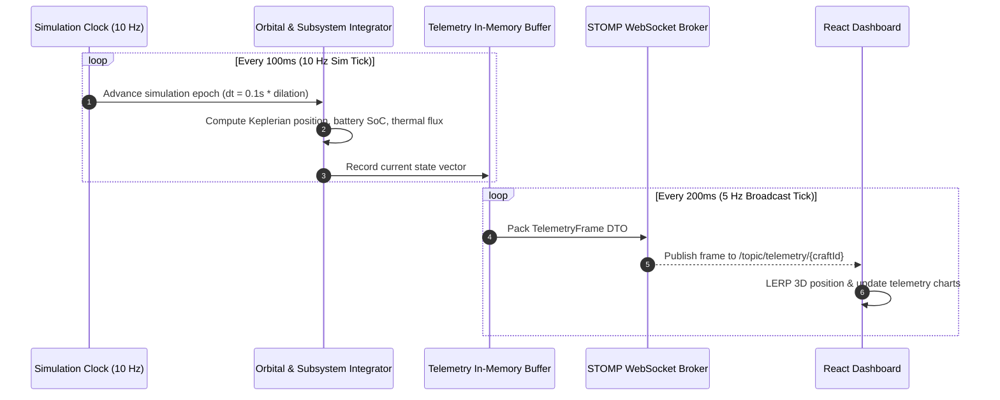
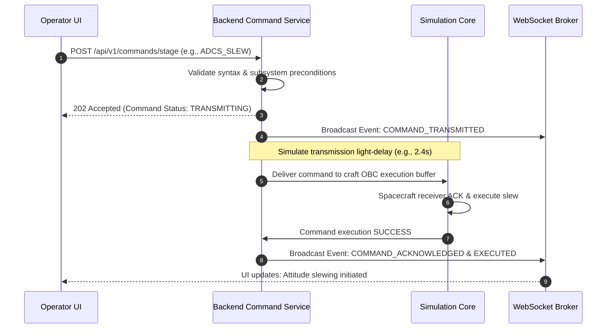

# ASTRA — System Architecture

**Document Version:** 1.0.0  
**Status:** Approved for Implementation (Phase 1)  
**Author:** Technical Architecture & Systems Engineering  
**Repository:** Astra

---

## 1. Architectural Philosophy & System Topology

ASTRA is designed as a **Modular Monolith** powered by **Java 21** and **Spring Boot 3.x** on the backend, paired with a modern **React + TypeScript + Vite + Three.js** single-page client, persisting to **Supabase-hosted PostgreSQL**.

```
+---------------------------------------------------------------------------------------------------------+
|                                              ASTRA CLIENT                                               |
|                                       (React / TypeScript / Vite)                                       |
|                                                                                                         |
|  +---------------------------+  +---------------------------+  +-------------------------------------+  |
|  |     Mission Control UI    |  |     Space Imagery UI      |  |      Three.js Orbital Viewport      |  |
|  |  - Telemetry Strip Charts |  |  - NASA Search & Filter   |  |  - Celestial Ephemeris              |  |
|  |  - Subsystem Matrix       |  |  - High-Res Inspector     |  |  - Orbit Trajectory Ribbons         |  |
|  |  - Command Terminal       |  |  - Metadata Sheet         |  |  - Spacecraft Attitude Rendering    |  |
|  |  - Failure Lab Console    |  |  - GIBS Earth Tiles       |  |  - Field-of-View Cone               |  |
|  +---------------------------+  +---------------------------+  +-------------------------------------+  |
|                |                              |                                    |                    |
|                +------------------------------+------------------------------------+                    |
|                                               |                                                         |
+-----------------------------------------------|---------------------------------------------------------+
                                                |
                         HTTP REST / JSON       |        WebSocket (STOMP)
                         (Commands, Queries,    |        (5 Hz Telemetry Broadcast,
                          NASA Gateway)         |         Real-Time Event Stream)
                                                v
+---------------------------------------------------------------------------------------------------------+
|                                          ASTRA BACKEND SERVICE                                          |
|                                   (Spring Boot 3.x / Java 21 Monolith)                                  |
|                                                                                                         |
|  +---------------------------------------------------------------------------------------------------+  |
|  |                                  Web & Transport Layer (REST & WS)                                |  |
|  +---------------------------------------------------------------------------------------------------+  |
|                                                  |                                                      |
|  +-------------------+  +-------------------+  +-------------------+  +------------------------------+  |
|  |  Fleet Management |  | Telemetry Stream  |  |  Command Pipeline |  |     Failure Lab Engine       |  |
|  |  - Craft Configs  |  |  - Frame Packing  |  |  - Validation     |  |  - Subsystem Anomaly FSMs    |  |
|  |  - Mission States |  |  - Ring Buffers   |  |  - Ack Lifecycle  |  |  - Fault Injection           |  |
|  +-------------------+  +-------------------+  +-------------------+  +------------------------------+  |
|            |                      |                      |                            |                 |
|  +---------------------------------------------------------------------------------------------------+  |
|  |                                    Deterministic Simulation Core                                  |  |
|  |  - Monotonic Simulation Clock               - RK4 / Keplerian Orbital Propagator                  |  |
|  |  - Subsystem Integrators (Power/Thermal/ADCS) - Time Dilation & Pause Manager                      |  |
|  +---------------------------------------------------------------------------------------------------+  |
|            |                                                                          |                 |
|  +-------------------+                                                        +----------------------+  |
|  | NASA Gateway API  |                                                        | Persistence & Audit  |  |
|  | - Images API Client                                                       | - Spring Data JPA    |  |
|  | - GIBS WMTS Proxy |                                                        | - Flyway Migrations  |  |
|  | - Cache & Quotas  |                                                        | - HikariCP Pool      |  |
|  +-------------------+                                                        +----------------------+  |
|            |                                                                             |              |
+------------|-----------------------------------------------------------------------------|--------------+
             |                                                                             |
             v                                                                             v
+-----------------------------+                                             +-----------------------------+
|    EXTERNAL NASA SERVICES   |                                             |   SUPABASE MANAGED CLOUD    |
| - images-api.nasa.gov       |                                             | - PostgreSQL Database       |
| - gibs.earthdata.nasa.gov   |                                             | - Row-Level Security (RLS)  |
| - api.nasa.gov (Optional)   |                                             | - Version-Controlled Schema |
+-----------------------------+                                             +-----------------------------+
```

### 1.1 Infrastructure Justification: Monolith vs Microservices
We explicitly reject microservices, Kafka, Redis, and Kubernetes at this stage:
- **Zero Network Serialization Overhead:** In-memory method invocations between the simulation clock, subsystem models, and telemetry packaging happen in nanoseconds, eliminating inter-service network latency and serialization failures.
- **Single Developer Operational Velocity:** A modular monolith can be built, tested, and debugged within a single IDE workspace using standard Maven commands.
- **In-Memory Ring Buffers:** Telemetry streaming needs low-latency circular buffers for the most recent 1,000 points per vehicle. An in-memory data structure in Java 21 handles this with near-zero latency, avoiding the operational overhead of a standalone Redis cluster.
- **Authoritative Determinism:** Keeping the simulation clock and orbital math within a single JVM process prevents split-brain states and distributed clock-skew anomalies.

---

## 2. Spring Boot Backend Domain Boundaries

The backend is structured into clear, decoupled domain packages within the monolithic codebase:

```
org.astra
 ├── core                  # Common types, timestamps, math primitives, physical constants
 ├── simulation            # Clock manager, Keplerian propagator, integration loop
 ├── fleet                 # Spacecraft entities, mission profiles, hardware parameters
 ├── telemetry             # Frame packaging, real-time dispatch, snapshot archive
 ├── commands              # Command staging, validation, uplink delay, execution
 ├── anomalies             # Six-domain failure state machines, fault injection
 ├── camera                # Simulated optical capture pipeline, metadata ledger
 ├── imagery               # NASA client integration, GIBS proxy, caching layer
 └── persistence           # JPA repositories, database entities, Flyway migrations
```

### 2.1 Domain Responsibilities

| Module | Primary Responsibility | Key Invariants |
| :--- | :--- | :--- |
| `core` | Provides coordinate math (ECI, ECEF, LVLH), Julian dates, physical constants ($\mu_{\text{Earth}}$, solar constant). | Pure, immutable functions. No database or network dependencies. |
| `simulation` | Advances physical and subsystem states deterministically based on tick interval ($\Delta t$) and time dilation multiplier. | The simulation clock is monotonic and authoritative. No random perturbations without seeded PRNG. |
| `fleet` | Maintains the catalog of spacecraft, their physical properties (mass, bus voltage, moment of inertia, sensor suites). | State changes occur only via the simulation engine or validated commands. |
| `telemetry` | Serializes vehicle state into `TelemetryFrame` records; buffers recent history; broadcasts via WebSockets. | Broadcast rate is decoupled from simulation tick rate (e.g., 10 Hz sim tick, 5 Hz network broadcast). |
| `commands` | Validates command parameters, simulates transmission delay, triggers execution, and tracks command resolution. | A command cannot transition to `EXECUTED` unless validated by subsystem preconditions. |
| `anomalies` | Holds the state machines for the 6 failure scenarios; injects state modifiers into the simulation core. | An anomaly cannot be cleared unless an appropriate recovery command sequence is executed. |
| `camera` | Calculates field-of-view intercepts, generates telemetry-stamped capture metadata, persists capture logs. | Must explicitly tag all output as synthetic and include vehicle orientation vectors. |
| `imagery` | Connects to NASA endpoints, provides server-side caching, enforces rate limits, proxies GIBS WMTS. | Must never expose NASA API keys to the browser; gracefully handles network disconnects. |
| `persistence` | Manages PostgreSQL tables via Spring Data JPA and Flyway migrations. | Supabase service keys stay strictly on the server; client never queries the database directly. |

---

## 3. Frontend Architecture (React + TypeScript + Three.js)

```
frontend/
 ├── src/
 │    ├── assets/              # Textures, planet normal maps, audio tones
 │    ├── components/          # Reusable instrument widgets
 │    │    ├── common/         # Buttons, panels, badges, modal dialogs
 │    │    ├── telemetry/      # Sparklines, radial gauges, status indicators
 │    │    ├── command/        # Command terminal, staging queues
 │    │    └── viewport/       # Three.js Canvas, celestial camera, orbit lines
 │    ├── features/            # Feature-specific page views
 │    │    ├── missioncontrol/ # Full telemetry console, fleet drawer, failure lab
 │    │    └── spaceimagery/   # NASA library browser, GIBS viewer, metadata sheet
 │    ├── hooks/               # Custom React hooks (useTelemetry, useWebSocket)
 │    ├── services/            # Axios REST client, STOMP WebSocket client
 │    ├── state/               # Lightweight client state store (Zustand or Context)
 │    ├── types/               # TypeScript interfaces matching backend DTOs
 │    ├── App.tsx              # Root application router (Dual-entry navigation)
 │    └── main.tsx             # Entry point
```

### 3.1 3D Viewport Architecture
- **Rendering Loop:** Managed via Three.js `requestAnimationFrame` loop maintaining target 60 FPS.
- **Coordinate Conversion:** Backend propagates orbits in kilometers; Three.js operates in scaled world units ($1\text{ unit} = 1,000\text{ km}$ for orbital scale, with logarithmic depth buffer enabled to prevent z-fighting).
- **Decoupled Interpolation:** Telemetry arrives at 5 Hz. The Three.js render loop linearly interpolates (LERP / SLERP) spacecraft position and quaternion orientation between telemetry packets to ensure silky camera and craft motion.

---

## 4. Database Strategy & Supabase Integration

### 4.1 Persistence Architecture
- **Engine:** PostgreSQL 15+ hosted on Supabase.
- **Migration Tool:** Flyway (SQL-based migrations versioned in `src/main/resources/db/migration`).
- **Connection Strategy:** Spring Boot manages connections via HikariCP directly to Supabase using standard JDBC over TLS (`sslmode=require`).
- **Security & RLS:** Supabase Row Level Security (RLS) is enabled by default. While backend queries execute over an authenticated connection pool, all tables have explicit security policies preventing anonymous external direct access.

```
+---------------------------------------------------------------------------------------+
|                                    FLYWAY MIGRATIONS                                  |
|                                                                                       |
|  V1__initial_schema.sql         -> Core tables: missions, spacecraft, hardware_config |
|  V2__telemetry_and_events.sql   -> Tables: telemetry_snapshots, mission_events        |
|  V3__command_pipeline.sql       -> Tables: commands, command_execution_log            |
|  V4__anomalies_and_captures.sql -> Tables: anomaly_definitions, simulated_captures    |
|  V5__imagery_cache.sql          -> Tables: nasa_asset_cache, gibs_layer_registry      |
+---------------------------------------------------------------------------------------+
```

---

## 5. API Boundaries & Communication Contracts

### 5.1 REST API Specification

| Endpoint | Method | Responsibility | Parameters / Body |
| :--- | :---: | :--- | :--- |
| `/api/v1/fleet` | `GET` | List all active spacecraft and their current status | None |
| `/api/v1/fleet/{id}` | `GET` | Get detailed specification and hardware profile for spacecraft | Path: `id` (UUID) |
| `/api/v1/simulation/time` | `GET` | Get current simulation epoch and time dilation | None |
| `/api/v1/simulation/time/control` | `POST` | Pause, resume, or adjust time dilation | `{ action: "PAUSE"\|"PLAY"\|"SET_DILATION", multiplier: 2.0 }` |
| `/api/v1/telemetry/{id}/history` | `GET` | Get recent historical telemetry ring buffer for vehicle | Query: `limit=100&since={epoch}` |
| `/api/v1/commands/stage` | `POST` | Validate and stage a new spacecraft command | `{ spacecraftId, commandType, parameters }` |
| `/api/v1/commands/{id}` | `GET` | Check command transmission and execution status | Path: `id` |
| `/api/v1/anomalies/catalog` | `GET` | Retrieve the catalog of 6 Failure Lab scenarios | None |
| `/api/v1/anomalies/inject` | `POST` | Inject a failure scenario into a target craft | `{ spacecraftId, anomalyCode, severity }` |
| `/api/v1/anomalies/{instanceId}/recover` | `POST` | Execute emergency recovery action | `{ instanceId, recoverySequence }` |
| `/api/v1/camera/capture` | `POST` | Trigger a simulated optical capture operation | `{ spacecraftId, target, exposureMs }` |
| `/api/v1/imagery/random` | `GET` | Fetch randomized NASA space imagery collection | Query: `count=12` |
| `/api/v1/imagery/search` | `GET` | Search NASA Image and Video Library | Query: `q={query}&media_type=image&page=1` |
| `/api/v1/imagery/gibs/layers` | `GET` | Get active NASA GIBS Earth observation layers | None |

### 5.2 WebSocket Telemetry Protocol (STOMP)

The platform uses Spring WebSocket with STOMP over SockJS fallback:
- **Broker Endpoint:** `/ws/telemetry`
- **Application Destination Prefix:** `/app`
- **Broker Destination Prefix:** `/topic`

#### Subscription Channels:
1. `/topic/telemetry/{spacecraftId}`: High-frequency (5 Hz) state broadcast containing kinematics, power, thermal, comms, and propulsion metrics.
2. `/topic/events/{spacecraftId}`: Operational alerts, orbit milestone crossings (periapsis, eclipse ingress/egress), and command execution ACKs.
3. `/topic/anomalies/{spacecraftId}`: Real-time anomaly status changes, degradation alarms, and recovery state updates.

---

## 6. Major Data Flows

### 6.1 Telemetry Broadcast Loop


### 6.2 Command Uplink & Verification Lifecycle


---

## 7. Operational Diagnostics & Structured Logging

The backend utilizes SLF4J with Logback configured for structured JSON output in production:
- **Trace IDs:** Every incoming REST request and WebSocket session is assigned a unique `traceId` (MDC context).
- **Audit Trails:** All command staging, failure injections, and recovery attempts write an immutable audit log entry containing: `operatorId`, `spacecraftId`, `actionCode`, `simEpoch`, `outcome`.
- **Health Indicators:** Custom Spring Boot Actuator endpoints (`/actuator/health`, `/actuator/metrics`) monitor:
  - Simulation loop drift (jitter in ms between scheduled tick and execution).
  - WebSocket active subscriber count per spacecraft topic.
  - NASA external gateway latency and circuit breaker status.
